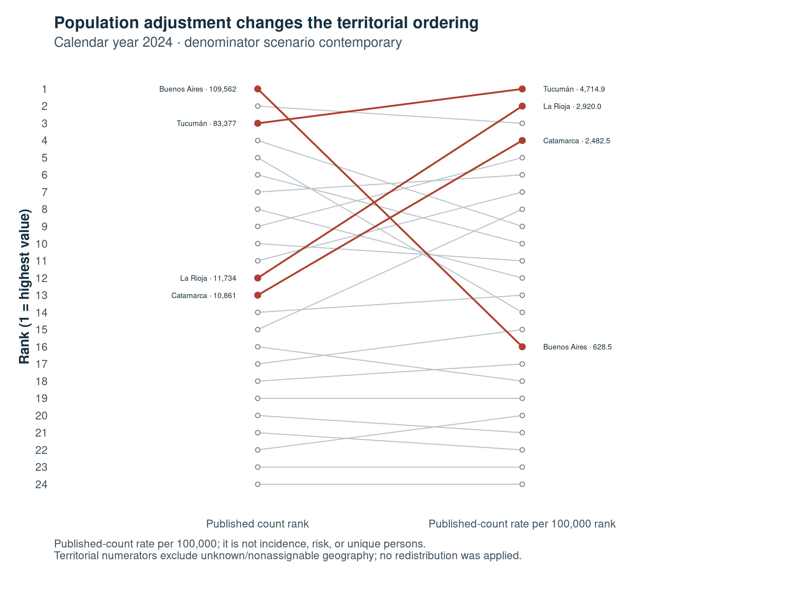

# Scientific Data Portfolio

Scientific data analysis projects built around reproducible analytics, data
quality, transparent assumptions, and careful interpretation of analytical
limits. The portfolio draws on experience in disease ecology, epidemiology,
environmental systems, and quantitative research.

## Featured projects

### Argentina Dengue Surveillance

Reproducible analysis of official Argentine dengue surveillance counts,
population-adjusted indicators, seasonal timing, and data-quality limits.

The project treats published surveillance counts as descriptive evidence: it
preserves provenance, makes analytical scope explicit, and does not overstate
incidence, individual risk, causal inference, or surveillance completeness.

**R · Quarto · Reproducible analytics**

- [Project](argentina-dengue-analysis/README.md)
- [Read report](https://etalii.github.io/scientific-data-portfolio/argentina-dengue-analysis/)

### Climate–Biodiversity Vulnerability in Argentina

**Phase 0 complete — environmental-data governance and reproducibility foundation.**

Contract-first R/spatial-data engineering, exact-object climate provenance,
independent raster characterization and evidence-bounded reporting for a larger
species-distribution and conservation study.

**R · Spatial-data engineering · Reproducibility · DataSpec**

Honest takeaway: the environmental pipeline is technically reproducible within
its certified scope; comparative and Argentina-specific conclusions remain
blocked. Species modelling, protected-area overlap and biodiversity-vulnerability
synthesis are not yet implemented.

- [Project](climate-biodiversity-vulnerability-argentina/README.md)
- [Phase 0 results and certified report](climate-biodiversity-vulnerability-argentina/portfolio/phase0/index.md)
- [Scientific roadmap](climate-biodiversity-vulnerability-argentina/docs/project_scientific_roadmap.md)

## Approach

This portfolio focuses on work where trustworthy results depend on more than a
final chart: source traceability, explicit data contracts, validation, and
plain-language communication of what the data can—and cannot—support.

Core interests include:

- Scientific and epidemiological data analysis
- Reproducible analytical workflows
- Data quality and provenance
- Environmental and disease-ecology reasoning
- Transparent analytical limitations

## Portfolio roadmap

[DataSpec](dataspec/v0.2/README.md) connects scientific questions, analytical
evidence, narrative specifications and review. The dengue project is the published
surveillance case study. Climate Phase 0 is a second, bounded environmental-data
foundation with a tracked reader report; its larger SDM/conservation study remains
prospective. Technical completion does not promote scientific authority.

## Contact

Andrés · [GitHub profile](https://github.com/etalii)
