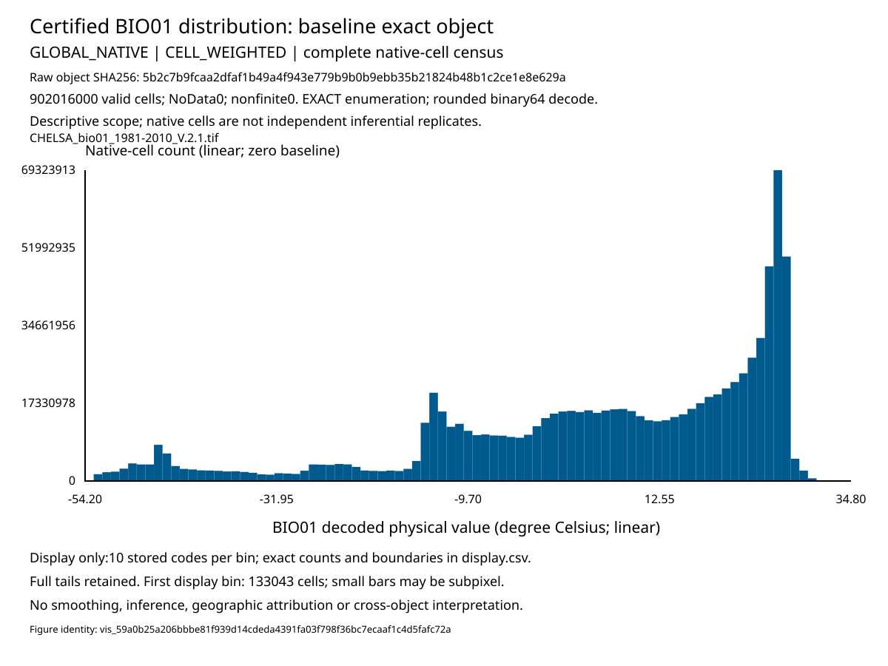

# Climate–Biodiversity Vulnerability in Argentina

**Phase 0: environmental data governance and reproducibility foundation**

Phase 0 — environmental-data governance and reproducibility foundation for a
larger climate–species-distribution–conservation study.

> **[Read the Phase 0 results and certified report →](portfolio/phase0/index.md)**

## Why this project exists

The larger goal is to study species-level climatic suitability under future
climate scenarios and how protected areas represent persistent or potentially
suitable locations. **This repository currently completes only Phase 0.** It has
not answered that original ecological question.

## Current scientific status

**Completed within the two-object climate pilot:** environmental source
governance; CHELSA object validation; reproducible native raster characterization;
independent descriptive statistics; visualization; evidence-bounded interpretation;
and reproducible reporting.

**Not yet implemented:** species selection, resolved taxonomic concepts,
occurrences, SDM, spatial cross-validation, GCM/SSP ensemble projections,
suitability gain/loss, protected-area overlap and vulnerability synthesis.
Protected-area source candidates are not an acquired analytical PA dataset.

## What Phase 0 demonstrates

- Contract-first scientific handoffs and reproducible R/spatial-data engineering.
- Exact-object provenance, immutable inputs and declared mask/decode policies.
- Semantic/geographic authority gates and scoped DataSpec lifecycle records.
- Adversarial validation and truthful scientific communication boundaries.

## Main outputs

- [Results, report and four independent certified visuals](portfolio/phase0/index.md).
- [Certified report — GitHub-readable Markdown](portfolio/phase0/report/report.md).
- [Offline HTML report](portfolio/phase0/report/report.html) — open locally; GitHub
  may display HTML source rather than render it.
- [Architecture reconciliation](docs/project_architecture_reconciliation.md)
  and [scientific objectives review](docs/project_scientific_objectives_review.md).
- [Prospective roadmap](docs/project_scientific_roadmap.md).

## Key result

The environmental pipeline is technically reproducible within its certified
scope and scientifically bounded. Comparative and Argentina-specific conclusions
remain blocked pending explicit authority. It establishes independent native-cell
descriptions, **not detected climate change or species vulnerability**.

One independent certified baseline-object histogram is shown below. Its original
SVG, alt text and full tails are preserved. No comparative panel is implied.



GLOBAL_NATIVE | CELL_WEIGHTED | census902016000 native cells | degree Celsius. EXACT enumeration; physical summaries use rounded IEEE754 binary64. NoData0; nonfinite0. Descriptive only; cells are spatially dependent, not independent inferential replicates. Full native valid support retained; no smoothing/normalization or scientific interpretation. Display data and exact source evidence are provided.

[Open this artifact with its full description and provenance](portfolio/phase0/visuals/vis_59a0b25a206bbbe81f939d14cdeda4391fa03f798f36bc7ecaaf1c4d5fafc72a/index.md).

## Scientific scope and limitations

- `GLOBAL_NATIVE != ARGENTINA`
- `CELL_WEIGHTED != AREA_WEIGHTED`
- `COMPARATIVE CLAIMS BLOCKED`
- `BIODIVERSITY-VULNERABILITY NOT YET AUTHORIZED`

Semantic authority is STRONG/family_only, not DIRECT/explicit exact-object linkage.
Cells are not independent inferential replicates. Technical mask/decode validity
is not universal climatic plausibility. Scientific/human acceptance remains
separate from technical certification. No inference, causality, conservation
effectiveness or national ecological finding is claimed.

## Architecture

**Completed Phase 0:** source/object governance → validation → native-reference
import → no-op reference cleaning → independent EDA/census → independent visual
communication → bounded interpretation → certified report.

**Planned larger study, not completed:** candidate species/taxonomy → occurrences
and QA → comparable predictors/domain → M/background and spatial folds → eligible
SDMs → scenario projections/novelty/uncertainty → suitability components →
protected-area representation → cross-species synthesis.

## Reproducibility

The complete tracked reader bundle needs **no R, Python, raw raster or local
receipt**. From a clone, open `portfolio/phase0/report/report.html` in a browser,
or read the Markdown directly on GitHub.

```sh
git clone https://github.com/etalii/scientific-data-portfolio.git
cd scientific-data-portfolio/climate-biodiversity-vulnerability-argentina
Rscript -e 'renv::restore(prompt = FALSE)'
Rscript scripts/publication/verify_phase0_bundle.R
```

The optional R commands verify existing static bytes; they do not run analysis.
R 4.1.2, renv 1.2.3 and required system libraries are the recorded reference
setup. [Reproducibility details](docs/phase0_reproducibility.md) distinguish an
isolated same-platform/cache-assisted restore from cold-network, cross-platform
or full scientific regeneration. Those broader reproductions are not claimed.

## Data and rights

Two governed CHELSA BIO01 objects and IGN country/province source snapshots retain
exact provenance. Raw rasters, geometry/documentary downloads, ordinary processed
bundles and local delivery receipts are excluded from Git. This task publishes
only exact authored report/visual copies, not raw external datasets.

[Data, citations and rights](docs/phase0_data_rights.md) explain source attribution,
exact-input verification and unresolved external-data redistribution. Project MIT
licensing does not relicense IGN or any other external source.

## Tech stack

**R primary · native GDAL/C window reads · sf geometry · renv · DataSpec**.
Python is not required to read or verify this publication. Another analytical
language would require a documented methodological or architectural advantage.

## Project status and roadmap

**Phase 0 COMPLETE. Full SDM/conservation study NOT YET COMPLETE.**

The next scientific phase recommended by the
[roadmap](docs/project_scientific_roadmap.md) is candidate species evidence,
taxonomy and eligibility design. No new phase is started by publication work.
See [publication readiness and retained-history limits](docs/project_publication_readiness_final.md).
