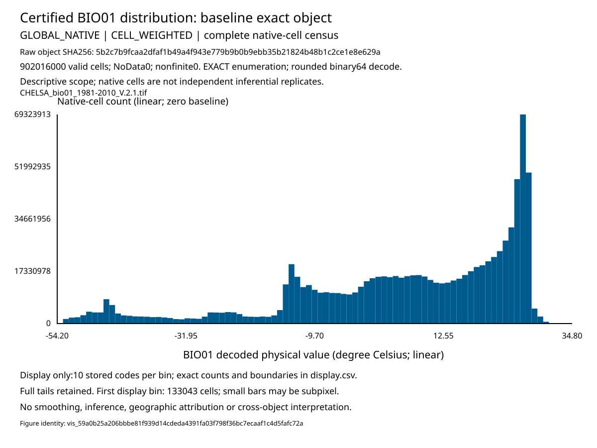

# Independent certified histogram and data

Exact object: `clim_stats_45bd3c4fe796cd1fd087fc414f55c67054710653f4b6f7ea6c39139febabf630`.

GLOBAL_NATIVE | CELL_WEIGHTED | census902016000 native cells | degree Celsius. EXACT enumeration; physical summaries use rounded IEEE754 binary64. NoData0; nonfinite0. Descriptive only; cells are spatially dependent, not independent inferential replicates. Full native valid support retained; no smoothing/normalization or scientific interpretation. Display data and exact source evidence are provided.

GLOBAL_NATIVE | CELL_WEIGHTED | census902016000 native cells | degree Celsius. EXACT enumeration; physical summaries use rounded IEEE754 binary64. NoData0; nonfinite0. Descriptive only; cells are spatially dependent, not independent inferential replicates. Full native valid support retained; no smoothing/normalization or scientific interpretation. Display data and exact source evidence are provided.

- [Exact display-bin counts](display.csv).
- [Exact source evidence](source_evidence.json).
- [Original certified visual inventory](inventory.json).
- [Unchanged report artifact page](../../report/vis_59a0b25a206bbbe81f939d14cdeda4391fa03f798f36bc7ecaaf1c4d5fafc72a_page.html).
- [Phase 0 reader index](../../index.md).

These are exact existing certified files, not new calculations. No comparative
interpretation, Argentina membership or independent inferential N is authorized.
